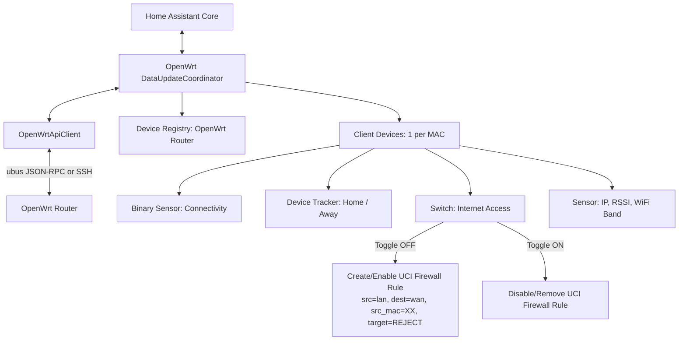

# Home Assistant OpenWrt Router Integration

[](https://github.com/hacs/default)
[](LICENSE)

A custom Home Assistant integration that connects to an **OpenWrt router** via `ubus` JSON-RPC or SSH, automatically discovers connected clients, exposes them as distinct Home Assistant devices with online/offline connectivity tracking, and provides parental/firewall control switches to block or allow internet access per device by managing OpenWrt firewall traffic rules.

---

## Features

- **Automatic Client Discovery**: Scans DHCP leases, ARP table, and wireless interfaces (`hostapd`) to discover all connected and known devices.
- **Dedicated Device per Client**: Each network client is registered as its own device in Home Assistant (linked via the OpenWrt router).
- **Online / Connectivity Status**: Real-time `binary_sensor` and `device_tracker` entities indicating whether each client is active on the network.
- **Firewall Internet Access Control**: A dedicated `switch` entity for each device that allows blocking or restoring internet access:
  - Dynamically creates/modifies OpenWrt UCI firewall traffic rules (`/etc/config/firewall`).
  - Blocks WAN egress for the specific MAC/IP while keeping local LAN access operational if desired.
  - Automatically reloads the firewall service (`fw4` on nftables or `fw3` on iptables).
- **Rich Telemetry**: Provides diagnostic sensors for IP address, MAC address, connection type (Ethernet, 2.4 GHz, 5 GHz), WiFi RSSI signal strength, and transfer rates.
- **Multi-Protocol Support**: Connects either through OpenWrt's native **ubus JSON-RPC over HTTP/HTTPS** (via `rpcd` / `uhttpd`) or secure **SSH execution** (`uci`).

---

## Prerequisites on OpenWrt

### Option A: ubus JSON-RPC (Recommended)

1. Ensure `rpcd` and `uhttpd-mod-ubus` are installed (default in modern OpenWrt installations):
   ```sh
   opkg update
   opkg install rpcd rpcd-mod-luci rpcd-mod-file uhttpd-mod-ubus
   /etc/init.d/uhttpd restart
   /etc/init.d/rpcd restart
   ```
2. Verify access to `/ubus` endpoint using an administrative user or configure dedicated RPC ACLs in `/usr/share/rpcd/acl.d/`.

### Option B: SSH

1. Configure SSH key or password authentication on port 22.
2. The user must have permissions to execute `uci`, `ubus`, and `/etc/init.d/firewall reload`.

---

## Development & Local Testing

### 1. Environment Setup with `uv`

```powershell
# Create virtual environment
uv venv --python 3.13

# Install dependencies in editable mode
uv pip install -e ".[dev]"
```

### 2. Linting & Formatting

```powershell
# Run ruff check
uv run ruff check .

# Run ruff format check
uv run ruff format --check .

# Run type checks
uv run mypy custom_components/openwrt-manager
```

### 3. Running Unit Tests

```powershell
uv run pytest
```

### 4. Running Local Mock OpenWrt Server

A mock server simulating OpenWrt ubus JSON-RPC is included in `scripts/mock_openwrt_server.py`:

```powershell
uv run python scripts/mock_openwrt_server.py --port 8080
```

### 5. Running Home Assistant via Docker Dev Environment

```powershell
docker compose up -d
```

Access Home Assistant at `http://localhost:8123`.

---

## Architecture Overview


